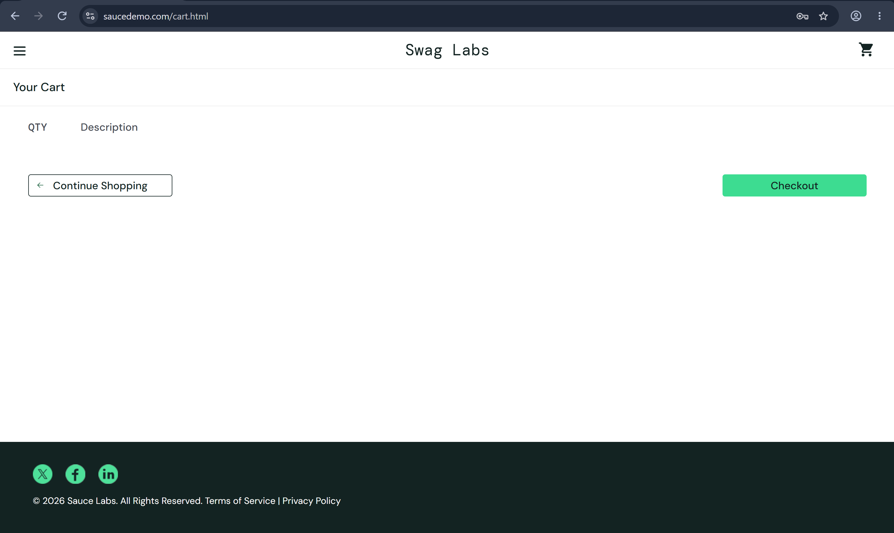
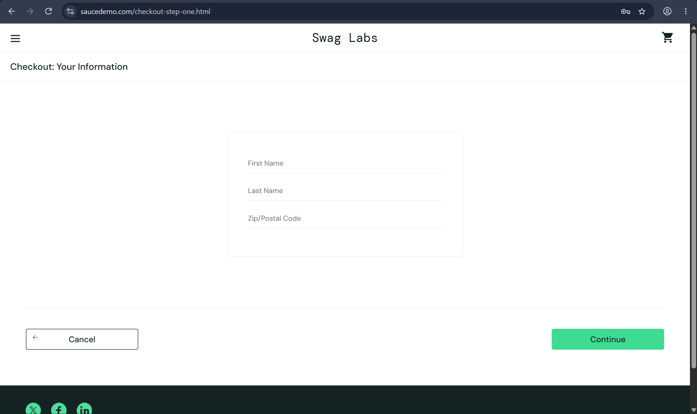

# BUG-001: [Cart] Checkout is allowed with an empty cart

| Field                    | Value           |
| ------------------------ | --------------- |
| **Bug ID**               | BUG-001         |
| **Module**               | Cart            |
| **Test account**         | `standard_user` |
| **Severity**             | Medium          |
| **Priority**             | Medium          |
| **Status**               | Open            |
| **Related test case(s)** | TC-CRT-10       |
| **Requirement**          | REQ-08          |
| **Reported by**          | Hanh Le         |
| **Reported on**          | 07/11/2026      |

## Environment

- **URL:** https://www.saucedemo.com
- **Browser:** Google Chrome 156.0.8078.74
- **OS:** Windows 11 Home 25H2

## Preconditions

- Logged in as `standard_user`.
- The cart is empty (no badge on the cart icon). Use 'Reset App State' in the menu if needed.

## Steps to Reproduce

1. Click the cart icon.
2. On 'Your Cart', check that no items are listed.
3. Click 'Checkout'.

## Expected Result

- Checkout is not allowed with an empty cart: the 'Checkout' button is disabled, or a message asks the user to add items.

## Actual Result

- The 'Checkout' button is enabled with an empty cart.
- Clicking it opens 'Checkout: Your Information' (/checkout-step-one.html).
- No message asks the user to add items.

## Evidence

1. Empty cart – the 'Checkout' button is still enabled:

2. After clicking 'Checkout' – 'Checkout: Your Information' is opened:

## Notes

- Expected result is based on common e-commerce practice; SauceDemo has no official requirement for this case.
