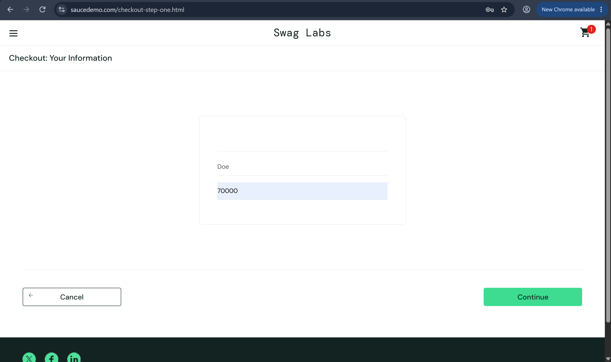
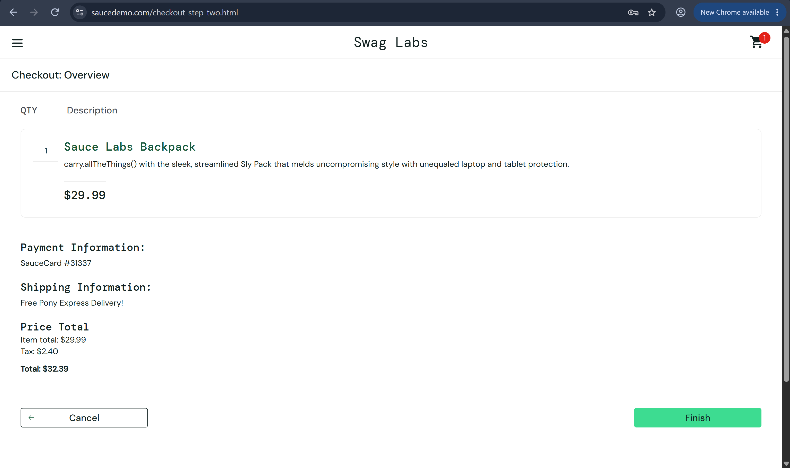
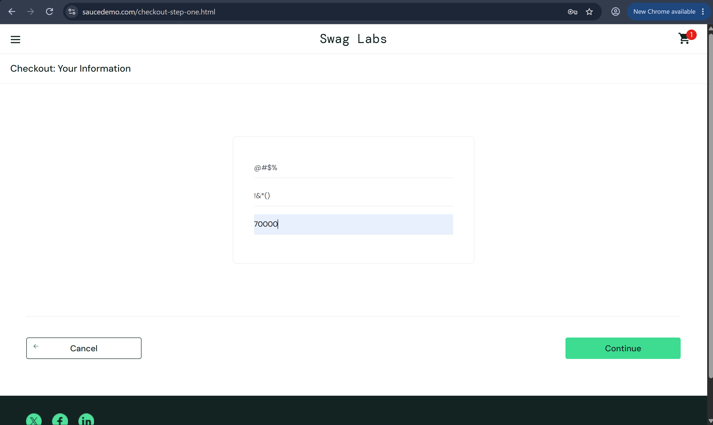
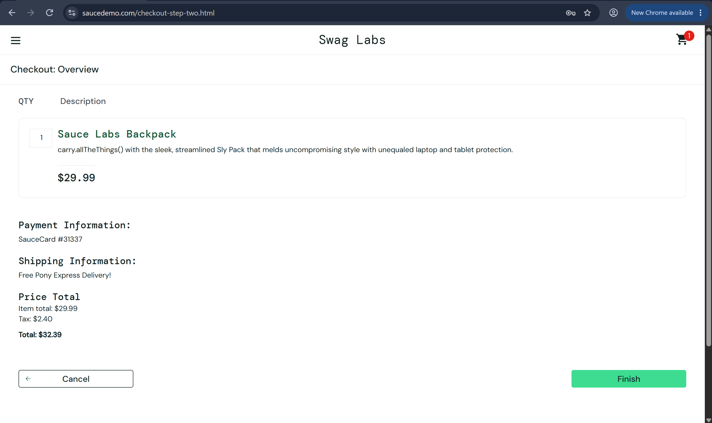
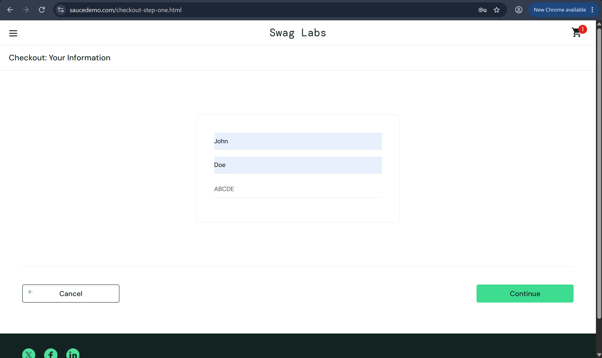

# BUG-002: [Checkout] Checkout information fields accept invalid input (whitespace-only, special characters, letters in Postal Code)

| Field                    | Value                           |
| ------------------------ | ------------------------------- |
| **Bug ID**               | BUG-002                         |
| **Module**               | Checkout                        |
| **Test account**         | `standard_user`                 |
| **Severity**             | Low                             |
| **Priority**             | Low                             |
| **Status**               | Open                            |
| **Related test case(s)** | TC-CHK-09, TC-CHK-10, TC-CHK-11 |
| **Requirement**          | REQ-09                          |
| **Reported by**          | Hanh Le                         |
| **Reported on**          | 07/11/2026                      |

## Environment

- **URL:** https://www.saucedemo.com
- **Browser:** Google Chrome 156.0.8078.74
- **OS:** Windows 11 Home 25H2

## Preconditions

- Logged in as `standard_user`.
- 'Sauce Labs Backpack' is in the cart.
- On 'Checkout: Your Information' (/checkout-step-one.html).

## Steps to Reproduce

1. Enter the test data of one row from the table below.
2. Click 'Continue'.
3. Repeat for each row (start from step 1 each time).

| Test case | First Name         | Last Name | Postal Code |
| --------- | ------------------ | --------- | ----------- |
| TC-CHK-09 | `'   '` (3 spaces) | `Doe`     | `70000`     |
| TC-CHK-10 | `@#$%`             | `!&*()`   | `70000`     |
| TC-CHK-11 | `John`             | `Doe`     | `ABCDE`     |

## Expected Result

- Invalid input is rejected with a validation error, and the user stays on 'Checkout: Your Information':
- a whitespace-only First Name is treated as empty ('Error: First Name is required');
- special characters in name fields are rejected;
- letters in Postal Code are rejected.

## Actual Result

- For all three inputs above, no error message is displayed. The input is accepted and 'Checkout: Overview' (/checkout-step-two.html) is displayed after clicking 'Continue'.

## Evidence

**TC-CHK-09 – Whitespace-only First Name**

**TC-CHK-10 – Special characters in name fields**

**TC-CHK-11 – Letters in Postal Code**

## Notes

- Expected result is based on common practice; SauceDemo has no official validation rules for these fields.
- The three cases are reported together because they share one cause: no input validation beyond 'field is not empty'.
