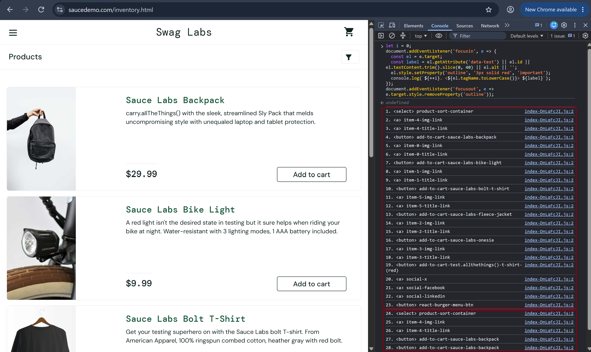
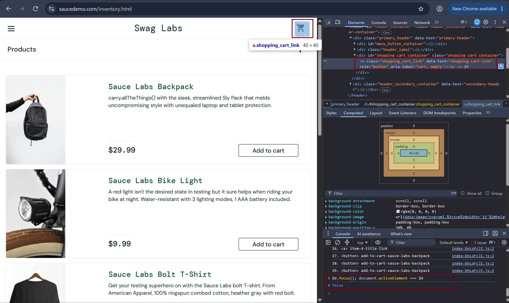

# BUG-003: [Accessibility] Cart icon cannot be reached with the keyboard; purchase cannot be completed without a mouse

| Field                    | Value           |
| ------------------------ | --------------- |
| **Bug ID**               | BUG-003         |
| **Module**               | Accessibility   |
| **Test account**         | `standard_user` |
| **Severity**             | High            |
| **Priority**             | High            |
| **Status**               | Open            |
| **Related test case(s)** | TC-NFT-05       |
| **Requirement**          | REQ-06, REQ-08  |
| **Reported by**          | Hanh Le         |
| **Reported on**          | 07/11/2026      |

## Environment

- **URL:** https://www.saucedemo.com
- **Browser:** Google Chrome 156.0.8078.74
- **OS:** Windows 11 Home 25H2

## Preconditions

- Logged in as `standard_user` and on the Products page.
- Click once on an empty area of the page so that keyboard focus is inside the page.

## Steps to Reproduce

1. Open DevTools > Console and run the focus-logging script (see _Test Script_ below).
2. Click once on an empty area of the page.
3. Press Tab repeatedly until focus returns to the first element (one full cycle). Repeat with Shift+Tab.
4. Check the console log: the cart icon never appears.
5. Right-click the cart icon > Inspect, then run in the console:
   `$0.focus(); document.activeElement === $0`

## Test Script

Used only to record the focus order (the page shows no focus indicator, see BUG-004).
It does not change the application behavior.

```javascript
let i = 0;
document.addEventListener('focusin', (e) => {
  const el = e.target;
  const label =
    el.getAttribute('data-test') ||
    el.id ||
    el.textContent.trim().slice(0, 40) ||
    el.alt ||
    '';
  el.style.setProperty('outline', '3px solid red', 'important');
  console.log(`${++i}. <${el.tagName.toLowerCase()}> ${label}`);
});
document.addEventListener('focusout', (e) =>
  e.target.style.removeProperty('outline'),
);
```

```javascript
$0.focus();
document.activeElement === $0;
```

## Expected Result

- Every interactive element, including the cart icon, can be reached with Tab and activated with Enter, so a keyboard-only user can open the cart and complete a purchase.

## Actual Result

- Focus order on the Products page: hamburger menu → sort dropdown → for each product: image → title → 'Add to cart' button → social links. The cycle then repeats in the same order.
- The cart icon never receives keyboard focus, so the cart page cannot be opened without a mouse.
- No other keyboard path to the cart was found (side menu, product detail page).
- The order cannot be completed using the keyboard only.

## Evidence

**1. Focus order on the Products page (one full Tab cycle)**

The console lists every element that received focus while pressing Tab.
After the last social link, focus returns to the hamburger menu (line [23]).
The cart icon never appears in the list.



**2. The cart icon cannot receive focus**

The cart icon is selected in the Elements panel (highlighted on the page).
Running `$0.focus(); document.activeElement === $0` in the console returns `false`,
so the browser does not allow keyboard focus on this element.



## Notes

- Typing /cart.html in the address bar is not counted as a workaround, because it is not navigation within the page.
