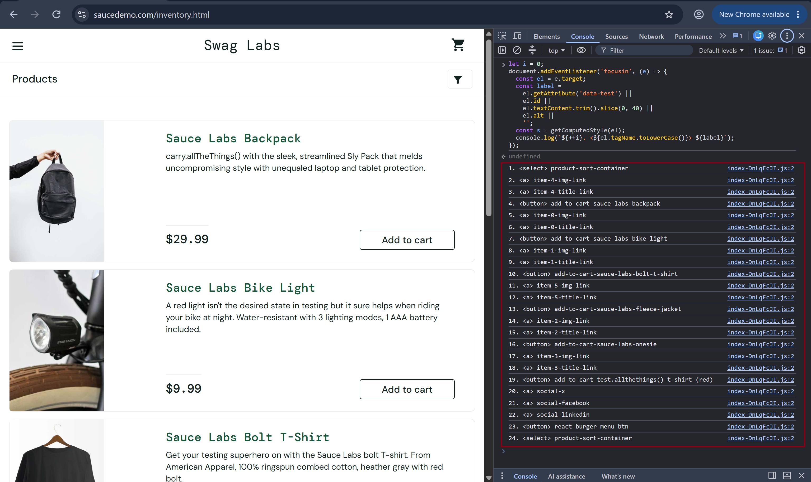

# BUG-004: [Accessibility] No visible focus indicator on interactive elements

| Field                    | Value                |
| ------------------------ | -------------------- |
| **Bug ID**               | BUG-004              |
| **Module**               | Accessibility        |
| **Test account**         | `standard_user`      |
| **Severity**             | Medium               |
| **Priority**             | Medium               |
| **Status**               | Open                 |
| **Related test case(s)** | TC-NFT-05, TC-NFT-04 |
| **Requirement**          | REQ-01, REQ-06       |
| **Reported by**          | Hanh Le              |
| **Reported on**          | 07/11/2026           |

## Environment

- **URL:** https://www.saucedemo.com
- **Browser:** Google Chrome 156.0.8078.74
- **OS:** Windows 11 Home 25H2

## Preconditions

- Browser at https://www.saucedemo.com (login page) or logged in as `standard_user` on the Products page.
- Click once on an empty area of the page so that keyboard focus is inside the page.

## Steps to Reproduce

1. Open DevTools > Console and run the focus-logging script (see _Test Script_ below).
2. Click once on an empty area of the page.
3. Press Tab repeatedly until focus returns to the first element (one full cycle).
4. Check the console log.

## Test Script

```javascript
let i = 0;
document.addEventListener('focusin', (e) => {
  const el = e.target;
  const label =
    el.getAttribute('data-test') ||
    el.id ||
    el.textContent.trim().slice(0, 40) ||
    el.alt ||
    '';
  console.log(`${++i}. <${el.tagName.toLowerCase()}> ${label}`);
});
```

## Expected Result

- The focused element is clearly highlighted (for example with an outline), so keyboard users can see where they are (WCAG 2.4.7 Focus Visible).

## Actual Result

- Focus moves between elements (confirmed by logging the focused element in the DevTools console), but no outline or highlight is shown on links and buttons.
- The user cannot see which element is currently focused without developer tools.

## Evidence

Pressing Tab moves the focus between elements: the console logs each focused element in order.
However, the focused element is not highlighted on the page, so the user cannot see where the focus is.



## Notes

- Related: BUG-003 (cart icon not reachable with the keyboard).
