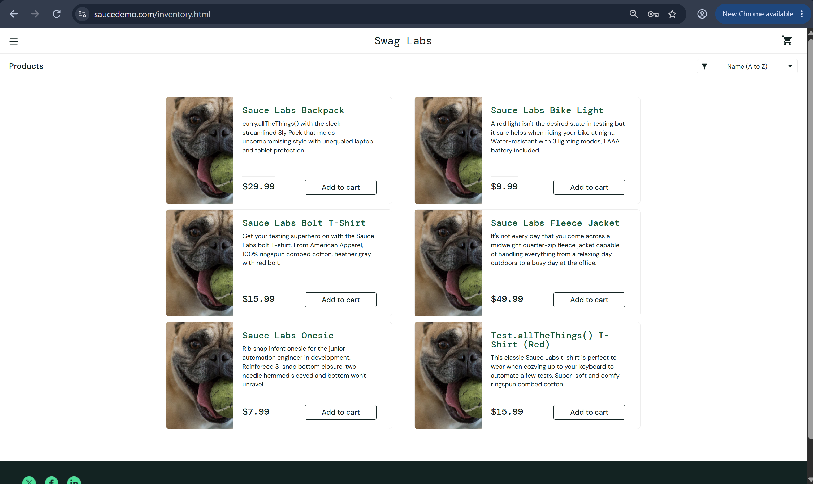

# BUG-005: [Inventory] problem_user: all products show the same wrong image

| Field                    | Value          |
| ------------------------ | -------------- |
| **Bug ID**               | BUG-005        |
| **Module**               | Inventory      |
| **Test account**         | `problem_user` |
| **Severity**             | Medium         |
| **Priority**             | Medium         |
| **Status**               | Open           |
| **Related test case(s)** | TC-ACC-01      |
| **Requirement**          | REQ-03         |
| **Reported by**          | Hanh Le        |
| **Reported on**          | 07/11/2026     |

## Environment

- **URL:** https://www.saucedemo.com
- **Browser:** Google Chrome 156.0.8078.74
- **OS:** Windows 11 Home 25H2

## Preconditions

- Open https://www.saucedemo.com and log in as `problem_user` / `secret_sauce`.

## Steps to Reproduce

1. On the Products page, look at the image of each of the 6 products.

## Expected Result

- Each product shows its own product image, the same as for `standard_user`.

## Actual Result

- All products show the same image, which is not a product image.

## Evidence

## Notes

- With `standard_user`, the same steps work correctly.
