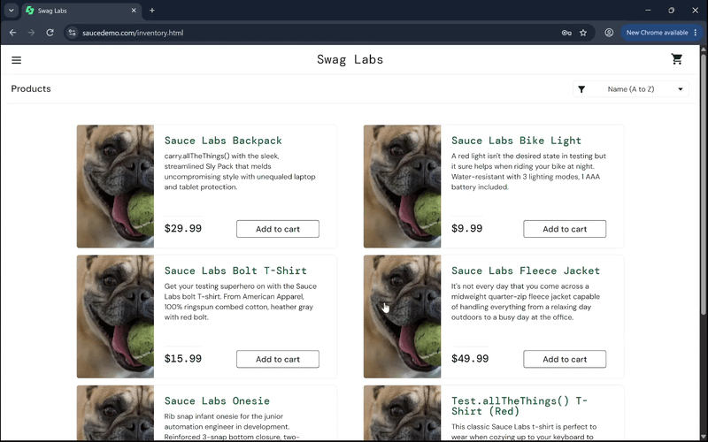

# BUG-006: [Inventory] problem_user: product links open the wrong product detail page

| Field                    | Value          |
| ------------------------ | -------------- |
| **Bug ID**               | BUG-006        |
| **Module**               | Inventory      |
| **Test account**         | `problem_user` |
| **Severity**             | High           |
| **Priority**             | High           |
| **Status**               | Open           |
| **Related test case(s)** | TC-ACC-04      |
| **Requirement**          | REQ-05         |
| **Reported by**          | Hanh Le        |
| **Reported on**          | 07/11/2026     |

## Environment

- **URL:** https://www.saucedemo.com
- **Browser:** Google Chrome 156.0.8078.74
- **OS:** Windows 11 Home 25H2

## Preconditions

- Open https://www.saucedemo.com and log in as `problem_user` / `secret_sauce`.

## Steps to Reproduce

1. On the Products page, click the name of a product (see table below).
2. Note which detail page opens.
3. Go back and repeat for each product.

| Clicked product                   | Detail page that opens            |
| --------------------------------- | --------------------------------- |
| Sauce Labs Backpack               | Sauce Labs Fleece Jacket          |
| Sauce Labs Bike Light             | Sauce Labs Bolt T-Shirt           |
| Sauce Labs Bolt T-Shirt           | Sauce Labs Onesie                 |
| Sauce Labs Onesie                 | Test.allTheThings() T-Shirt (Red) |
| Test.allTheThings() T-Shirt (Red) | Sauce Labs Backpack               |

## Expected Result

- Each product name opens the detail page of the same product.

## Actual Result

- 5 of 6 product links open the detail page of a different product (see table).

## Evidence

[Full recording (MP4)](../evidence/videos/BUG-006_wrong-product-links.mp4)

## Notes

- With `standard_user`, the same steps work correctly.
- The sixth product (Sauce Labs Fleece Jacket) shows 'ITEM NOT FOUND'; this is reported separately in BUG-007.
