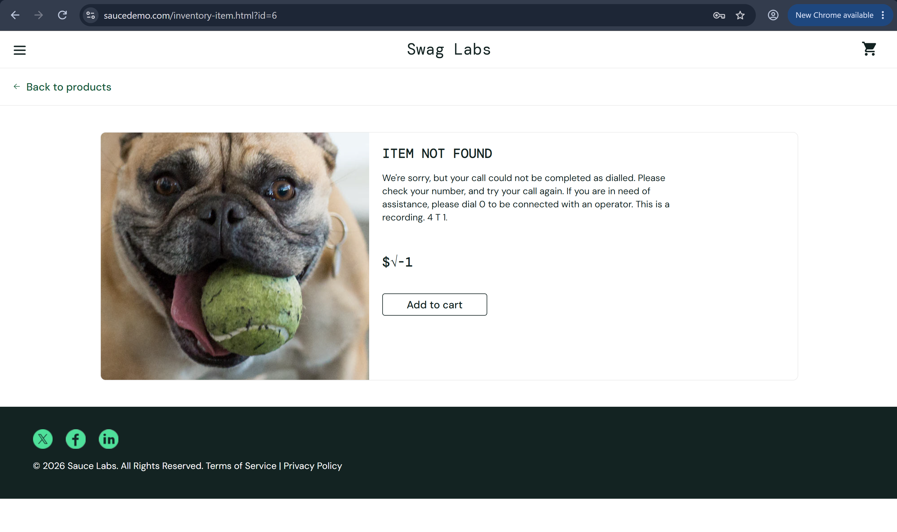

# BUG-007: [Product Detail] problem_user: 'Sauce Labs Fleece Jacket' link shows 'ITEM NOT FOUND'

| Field                    | Value          |
| ------------------------ | -------------- |
| **Bug ID**               | BUG-007        |
| **Module**               | Product Detail |
| **Test account**         | `problem_user` |
| **Severity**             | High           |
| **Priority**             | High           |
| **Status**               | Open           |
| **Related test case(s)** | TC-ACC-04      |
| **Requirement**          | REQ-05         |
| **Reported by**          | Hanh Le        |
| **Reported on**          | 07/11/2026     |

## Environment

- **URL:** https://www.saucedemo.com
- **Browser:** Google Chrome 156.0.8078.74
- **OS:** Windows 11 Home 25H2

## Preconditions

- Open https://www.saucedemo.com and log in as `problem_user` / `secret_sauce`.

## Steps to Reproduce

1. On the Products page, click the name 'Sauce Labs Fleece Jacket'.

## Expected Result

- The detail page of Sauce Labs Fleece Jacket is displayed.

## Actual Result

- A page with the message 'ITEM NOT FOUND' is displayed. The product details cannot be viewed.

## Evidence

[Full recording (MP4)](../evidence/videos/BUG-007_item-not-found.mp4)

## Notes

- With `standard_user`, the same steps work correctly.
- Related: BUG-006 (other product links open the wrong product).
