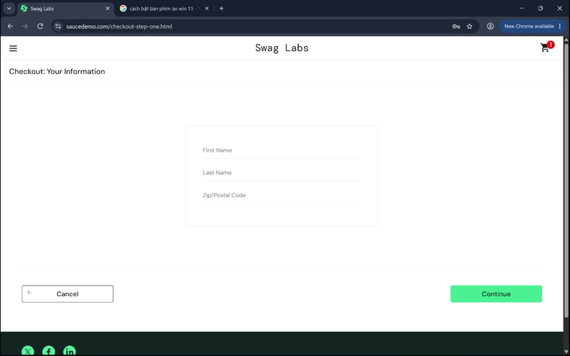

# BUG-008: [Checkout] problem_user: typing in Last Name updates First Name; checkout cannot be completed

| Field                    | Value          |
| ------------------------ | -------------- |
| **Bug ID**               | BUG-008        |
| **Module**               | Checkout       |
| **Test account**         | `problem_user` |
| **Severity**             | Critical       |
| **Priority**             | High           |
| **Status**               | Open           |
| **Related test case(s)** | TC-ACC-05      |
| **Requirement**          | REQ-09, REQ-11 |
| **Reported by**          | Hanh Le        |
| **Reported on**          | 09/11/2026     |

## Environment

- **URL:** https://www.saucedemo.com
- **Browser:** Google Chrome 156.0.8078.74
- **OS:** Windows 11 Home 25H2

## Preconditions

- Open https://www.saucedemo.com and log in as `problem_user` / `secret_sauce`.
- The cart is empty (use 'Reset App State' if needed).

## Steps to Reproduce

1. Click 'Add to cart' for Sauce Labs Backpack.
2. Open the cart and click 'Checkout'.
3. Enter First Name: `John`.
4. Click in the Last Name field and type `Doe`.
5. Enter Postal Code: `70000`.
6. Click 'Continue'.

## Expected Result

- Each field keeps its own value; 'Checkout: Overview' is displayed and the order can be completed with 'Thank you for your order!'.

## Actual Result

- First Name `John` is entered correctly.
- When typing `Doe` in the Last Name field, the text appears in the First Name field instead. The Last Name field stays empty.
- After clicking 'Continue', 'Error: Last Name is required' is displayed.
- The checkout cannot be completed; the 'Finish' step is never reached. No workaround was found.

## Evidence

[Full recording (MP4)](../evidence/videos/BUG-008_last-name-overwrites-first-name.mp4)

## Notes

- With `standard_user`, the same steps work correctly.
