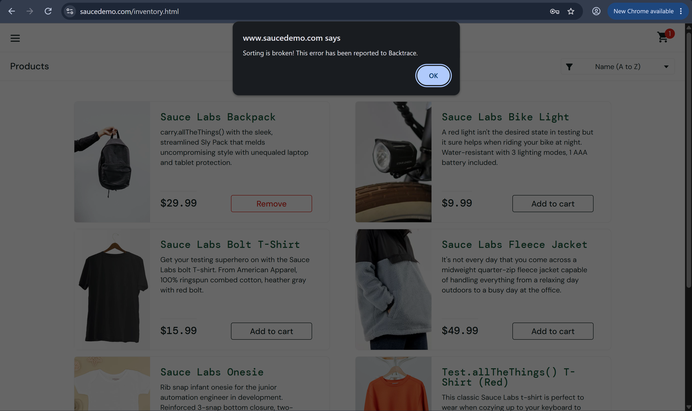

# BUG-009: [Inventory] error_user: Z-A and price sort options show 'Sorting is broken!' alert and products are not sorted

| Field                    | Value        |
| ------------------------ | ------------ |
| **Bug ID**               | BUG-009      |
| **Module**               | Inventory    |
| **Test account**         | `error_user` |
| **Severity**             | Medium       |
| **Priority**             | Medium       |
| **Status**               | Open         |
| **Related test case(s)** | TC-ACC-06    |
| **Requirement**          | REQ-04       |
| **Reported by**          | Hanh Le      |
| **Reported on**          | 09/11/2026   |

## Environment

- **URL:** https://www.saucedemo.com
- **Browser:** Google Chrome 156.0.8078.74
- **OS:** Windows 11 Home 25H2

## Preconditions

- Open https://www.saucedemo.com and log in as `error_user` / `secret_sauce`.

## Steps to Reproduce

1. On the Products page, select 'Name (Z to A)' in the sort dropdown.
2. Click 'OK' on the alert.
3. Repeat with 'Price (low to high)' and 'Price (high to low)'.

## Expected Result

- Products are sorted according to the selected option, with no error (same as `standard_user`).

## Actual Result

- A browser alert is displayed: 'Sorting is broken! This error has been reported to Backtrace.'
- After clicking 'OK', the product order is unchanged (still A to Z).
- This happens for 'Name (Z to A)', 'Price (low to high)' and 'Price (high to low)'. 'Name (A to Z)' (the default) works normally.

## Evidence

## Notes

- With `standard_user`, the same steps work correctly.
