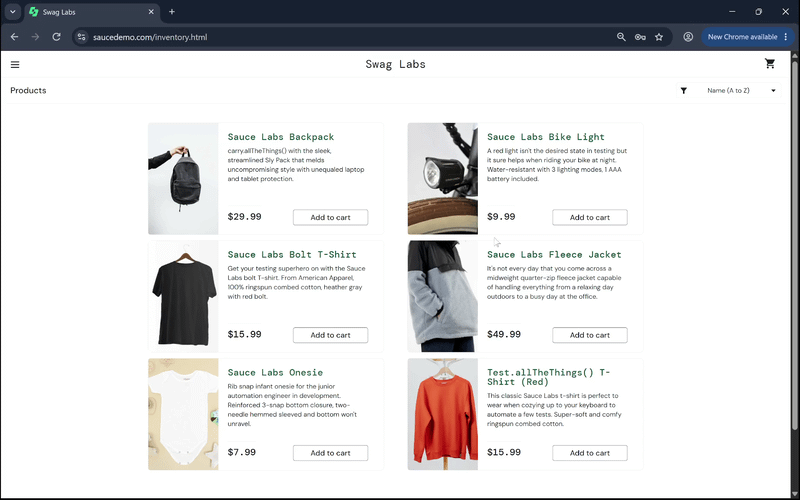

# BUG-010: [Inventory] error_user: some products cannot be added to the cart

| Field                    | Value          |
| ------------------------ | -------------- |
| **Bug ID**               | BUG-010        |
| **Module**               | Inventory      |
| **Test account**         | `error_user`   |
| **Severity**             | High           |
| **Priority**             | High           |
| **Status**               | Open           |
| **Related test case(s)** | TC-ACC-07      |
| **Requirement**          | REQ-06, REQ-07 |
| **Reported by**          | Hanh Le        |
| **Reported on**          | 09/11/2026     |

## Environment

- **URL:** https://www.saucedemo.com
- **Browser:** Google Chrome 156.0.8078.74
- **OS:** Windows 11 Home 25H2

## Preconditions

- Open https://www.saucedemo.com and log in as `error_user` / `secret_sauce`.
- The cart is empty.

## Steps to Reproduce

1. On the Products page, click 'Add to cart' for each of the products listed below.

## Expected Result

- The button changes to 'Remove' and the cart badge increases by 1 for each product.

## Actual Result

- For the products below, clicking 'Add to cart' does nothing: the button does not change and the cart badge is unchanged.
- Affected products: Sauce Labs Bolt T-Shirt, Sauce Labs Fleece Jacket, Test.allTheThings() T-Shirt (Red).
- Users cannot buy these products.

## Evidence

[Full recording (MP4)](../evidence/videos/BUG-010_add-remove-products.mp4)

## Notes

- With `standard_user`, the same steps work correctly.
- Related: BUG-011 (other products can be added but not removed).
