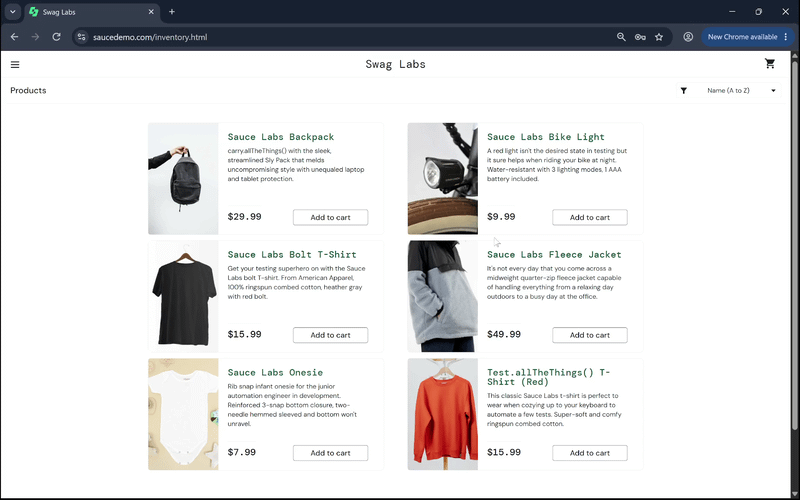

# BUG-011: [Inventory] error_user: some products cannot be removed from the cart

| Field                    | Value          |
| ------------------------ | -------------- |
| **Bug ID**               | BUG-011        |
| **Module**               | Inventory      |
| **Test account**         | `error_user`   |
| **Severity**             | High           |
| **Priority**             | High           |
| **Status**               | Open           |
| **Related test case(s)** | TC-ACC-07      |
| **Requirement**          | REQ-06, REQ-07 |
| **Reported by**          | Hanh Le        |
| **Reported on**          | 09/11/2026     |

## Environment

- **URL:** https://www.saucedemo.com
- **Browser:** Google Chrome 156.0.8078.74
- **OS:** Windows 11 Home 25H2

## Preconditions

- Open https://www.saucedemo.com and log in as `error_user` / `secret_sauce`.
- The cart is empty.

## Steps to Reproduce

1. On the Products page, click 'Add to cart' for Sauce Labs Backpack, Sauce Labs Bike Light and Sauce Labs Onesie.
2. Click 'Remove' for each of these products.

## Expected Result

- Each product is removed: the button changes back to 'Add to cart' and the cart badge decreases.

## Actual Result

- Adding works (the cart badge updates correctly), but clicking 'Remove' does nothing: the products stay in the cart and the badge is unchanged.
- Affected products: Sauce Labs Backpack, Sauce Labs Bike Light, Sauce Labs Onesie.

## Evidence

The same recording as in [BUG-010](BUG-010.md) shows both adding and removing:

[Full recording (MP4)](../evidence/videos/BUG-010_add-remove-products.mp4)

## Notes

- With `standard_user`, the same steps work correctly.
- The products cannot be removed on the Cart page or the product detail page either; there is no workaround.
