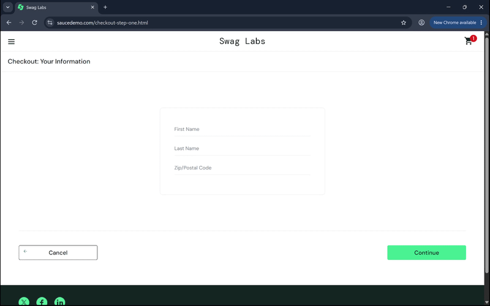

# BUG-012: [Checkout] error_user: Last Name field does not accept input and 'Finish' does nothing; order cannot be completed

| Field                    | Value          |
| ------------------------ | -------------- |
| **Bug ID**               | BUG-012        |
| **Module**               | Checkout       |
| **Test account**         | `error_user`   |
| **Severity**             | Critical       |
| **Priority**             | High           |
| **Status**               | Open           |
| **Related test case(s)** | TC-ACC-08      |
| **Requirement**          | REQ-09, REQ-11 |
| **Reported by**          | Hanh Le        |
| **Reported on**          | 09/11/2026     |

## Environment

- **URL:** https://www.saucedemo.com
- **Browser:** Google Chrome 156.0.8078.74
- **OS:** Windows 11 Home 25H2

## Preconditions

- Open https://www.saucedemo.com and log in as `error_user` / `secret_sauce`.
- The cart is empty (use 'Reset App State' if needed).

## Steps to Reproduce

1. Click 'Add to cart' for Sauce Labs Backpack.
2. Open the cart and click 'Checkout'.
3. Enter First Name: `John`.
4. Click in the Last Name field and type `Doe`.
5. Enter Postal Code: `70000` and click 'Continue'.
6. On 'Checkout: Overview', click 'Finish'.

## Expected Result

- The Last Name field shows `Doe`.
- Clicking 'Finish' completes the order and shows 'Thank you for your order!'.

## Actual Result

- When typing `Doe` in the Last Name field, no text appears; the field stays empty.
- Clicking 'Finish' on 'Checkout: Overview' does nothing; the order cannot be completed.

## Evidence

[Full recording (MP4)](../evidence/videos/BUG-012_last-name-finish-fail.mp4)

## Notes

- With `standard_user`, the same steps work correctly.
- Related: BUG-013 (the empty Last Name is not validated, so the user reaches the overview).
