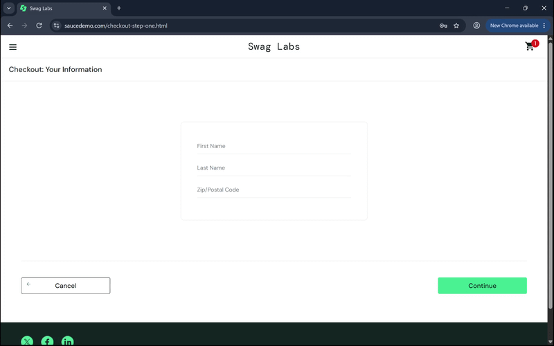

# BUG-013: [Checkout] error_user: checkout continues with an empty Last Name (required-field validation skipped)

| Field                    | Value        |
| ------------------------ | ------------ |
| **Bug ID**               | BUG-013      |
| **Module**               | Checkout     |
| **Test account**         | `error_user` |
| **Severity**             | Medium       |
| **Priority**             | Medium       |
| **Status**               | Open         |
| **Related test case(s)** | TC-ACC-08    |
| **Requirement**          | REQ-09       |
| **Reported by**          | Hanh Le      |
| **Reported on**          | 09/11/2026   |

## Environment

- **URL:** https://www.saucedemo.com
- **Browser:** Google Chrome 156.0.8078.74
- **OS:** Windows 11 Home 25H2

## Preconditions

- Open https://www.saucedemo.com and log in as `error_user` / `secret_sauce`.
- 'Sauce Labs Backpack' is in the cart; on 'Checkout: Your Information'.

## Steps to Reproduce

1. Enter First Name: `John` and Postal Code: `70000`. The Last Name field is empty (it does not accept input, see BUG-012).
2. Click 'Continue'.

## Expected Result

- 'Error: Last Name is required' is displayed and the user stays on 'Checkout: Your Information' (same as `standard_user`).

## Actual Result

- No error is shown. 'Checkout: Overview' is displayed with an empty Last Name.

## Evidence

[Full recording (MP4)](../evidence/videos/BUG-013_empty-last-name-accepted.mp4)

## Notes

- With `standard_user`, an empty Last Name shows 'Error: Last Name is required'.
