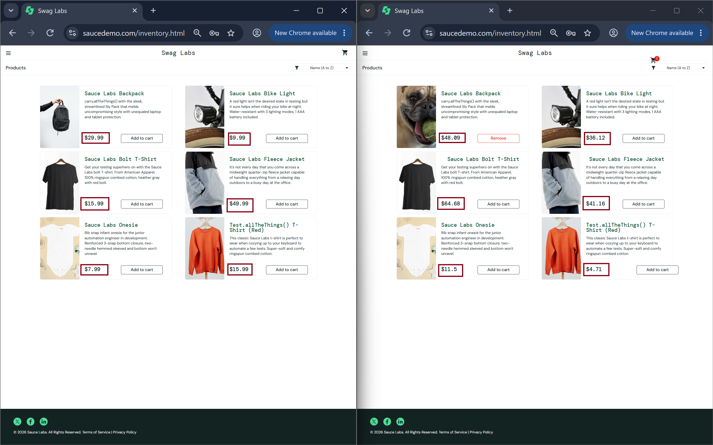
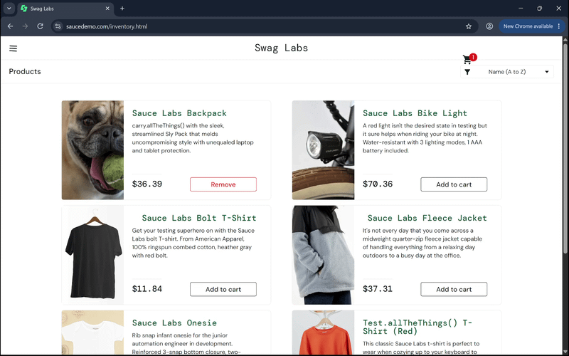

# BUG-014: [Inventory] visual_user: product prices differ from cart/checkout prices and change when sorting

| Field                    | Value                |
| ------------------------ | -------------------- |
| **Bug ID**               | BUG-014              |
| **Module**               | Inventory            |
| **Test account**         | `visual_user`        |
| **Severity**             | High                 |
| **Priority**             | High                 |
| **Status**               | Open                 |
| **Related test case(s)** | TC-ACC-09, TC-ACC-10 |
| **Requirement**          | REQ-03, REQ-10       |
| **Reported by**          | Hanh Le              |
| **Reported on**          | 09/11/2026           |

## Environment

- **URL:** https://www.saucedemo.com
- **Browser:** Google Chrome 156.0.8078.74
- **OS:** Windows 11 Home 25H2

## Preconditions

- Open https://www.saucedemo.com and log in as `visual_user` / `secret_sauce`.
- Open a second window logged in as `standard_user` for comparison.

## Steps to Reproduce

1. Compare the prices on the Products page with `standard_user`.
2. Select different sort options and observe the prices.
3. Add Sauce Labs Backpack, open the cart and continue to 'Checkout: Overview'.

## Expected Result

- The same price is shown for a product on the Products page, in the cart and at checkout, and prices do not change when sorting.

## Actual Result

- All prices on the Products page differ from `standard_user` (e.g. Sauce Labs Backpack: $48.09 instead of $29.99 in one run; the value changes with every sort, see Evidence 2).
- All prices change every time a different sort option is selected.
- In the cart, the price shown is the `standard_user` price (Sauce Labs Backpack: $29.99), which differs from the Products page.
- Checkout: Overview also uses `standard_user` prices: Item total $29.99, Tax $2.40, Total $32.39.

## Evidence

**1. Products page: standard_user (left) vs visual_user (right)**

At the time of the screenshot, Sauce Labs Backpack is shown at $48.09 for visual_user and $29.99 for standard_user.
The visual_user price is different each time the sort option changes.

**2. Prices change when a different sort option is selected (visual_user)**

[Full recording (MP4)](../evidence/videos/BUG-014_2-prices-change-on-sort.mp4)

**3. Cart page (visual_user): Sauce Labs Backpack is $29.99**

The cart uses the standard_user price, which differs from the price shown on the Products page (e.g. $48.09).
Checkout: Overview also uses $29.99 (Item total $29.99, Tax $2.40, Total $32.39).

[Full recording (MP4)](../evidence/videos/BUG-014_3-cart-price.mp4)

## Notes

- The amount charged at checkout is correct; the defect is that users see a different price when choosing products. If the checkout amount were also wrong, severity would be Critical.
