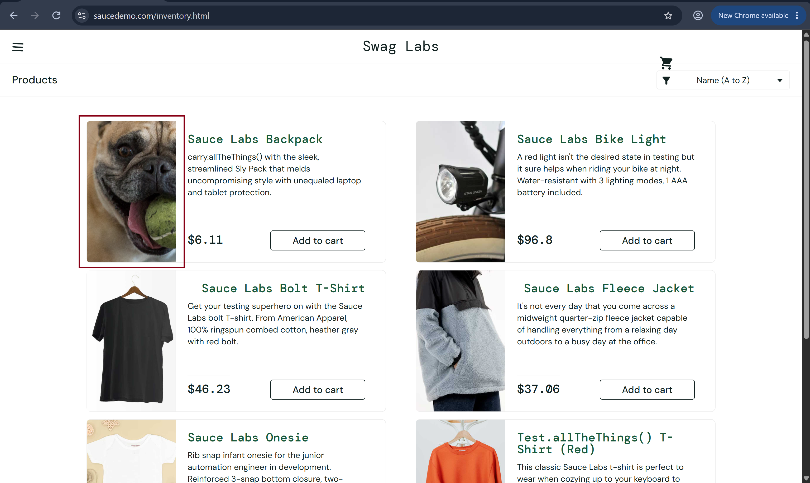

# BUG-015: [Inventory] visual_user: top-left product shows a dog image instead of its product image

| Field                    | Value         |
| ------------------------ | ------------- |
| **Bug ID**               | BUG-015       |
| **Module**               | Inventory     |
| **Test account**         | `visual_user` |
| **Severity**             | Medium        |
| **Priority**             | Low           |
| **Status**               | Open          |
| **Related test case(s)** | TC-ACC-09     |
| **Requirement**          | REQ-03        |
| **Reported by**          | Hanh Le       |
| **Reported on**          | 09/11/2026    |

## Environment

- **URL:** https://www.saucedemo.com
- **Browser:** Google Chrome 156.0.8078.74
- **OS:** Windows 11 Home 25H2

## Preconditions

- Open https://www.saucedemo.com and log in as `visual_user` / `secret_sauce`.

## Steps to Reproduce

1. On the Products page (default sort 'Name (A to Z)'), look at the image of the first product (top-left).

## Expected Result

- The product shows its own product image, the same as for `standard_user`.

## Actual Result

- The top-left product always shows a dog image instead of its product image.

## Evidence

## Notes

- With `standard_user`, the same steps work correctly.
