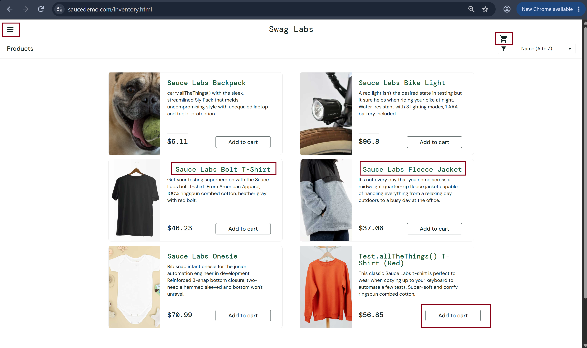
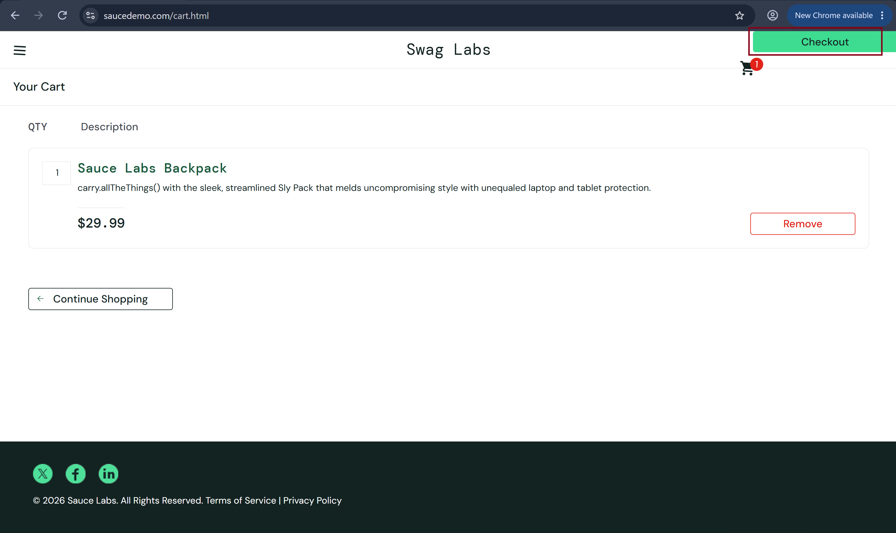

# BUG-016: [UI] visual_user: layout defects on Products and Cart pages (button overflow, tilted/misaligned icons, indented names, Checkout button position)

| Field                    | Value                |
| ------------------------ | -------------------- |
| **Bug ID**               | BUG-016              |
| **Module**               | UI                   |
| **Test account**         | `visual_user`        |
| **Severity**             | Low                  |
| **Priority**             | Low                  |
| **Status**               | Open                 |
| **Related test case(s)** | TC-ACC-09, TC-ACC-10 |
| **Requirement**          | REQ-03, REQ-08       |
| **Reported by**          | Hanh Le              |
| **Reported on**          | 09/11/2026           |

## Environment

- **URL:** https://www.saucedemo.com
- **Browser:** Google Chrome 156.0.8078.74
- **OS:** Windows 11 Home 25H2

## Preconditions

- Open https://www.saucedemo.com and log in as `visual_user` / `secret_sauce`.
- Open a second window logged in as `standard_user` for side-by-side comparison.

## Steps to Reproduce

1. Compare the Products page with `standard_user`.
2. Add a product, open the cart and compare the Cart page.

## Expected Result

- Layout, icons, text alignment and button positions are identical to `standard_user`.

## Actual Result

- Products page: the 'Add to cart' button of the bottom-right product overflows the product card.
- Products page: the cart icon is tilted and misaligned (shifted lower and to the left).
- Products page: the hamburger menu icon is tilted to the right.
- Products page: the product names in the second row are indented compared with the other rows.
- Cart page (/cart.html): the 'Checkout' button is at the top-right of the page instead of the bottom-right next to 'Continue Shopping'.

## Evidence

1. Products page – button overflow, tilted icons, indented names:

2. Cart page – 'Checkout' button at the top-right:

## Notes

- Cosmetic issues with the same cause (visual_user styling) are grouped in one report. 'Checkout: Your Information' and 'Checkout: Overview' showed no visual differences.
