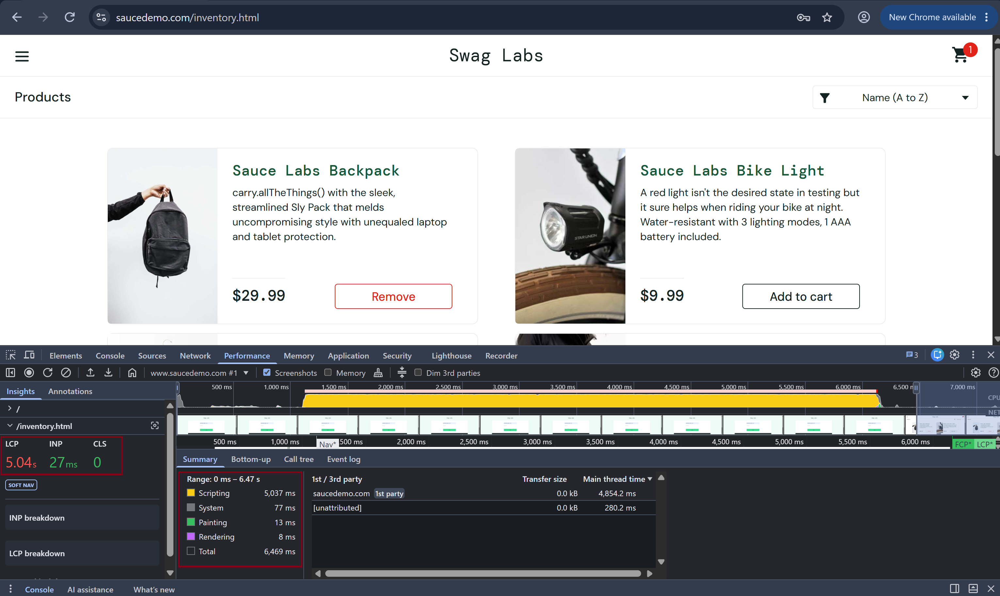
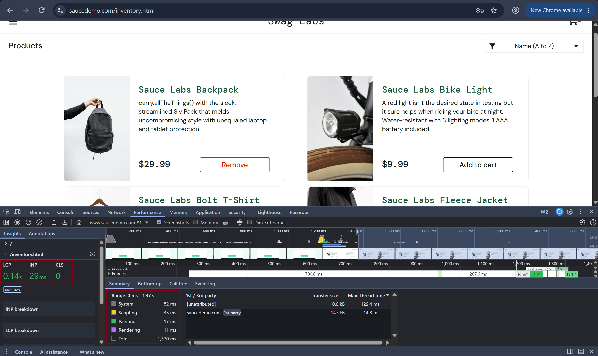

# BUG-017: [Performance] performance_glitch_user: Products page takes about 5 s to load after login (target: 3 s)

| Field                    | Value                     |
| ------------------------ | ------------------------- |
| **Bug ID**               | BUG-017                   |
| **Module**               | Performance               |
| **Test account**         | `performance_glitch_user` |
| **Severity**             | Medium                    |
| **Priority**             | Medium                    |
| **Status**               | Open                      |
| **Related test case(s)** | TC-ACC-11                 |
| **Requirement**          | REQ-01, REQ-03            |
| **Reported by**          | Hanh Le                   |
| **Reported on**          | 09/11/2026                |

## Environment

- **URL:** https://www.saucedemo.com
- **Browser:** Google Chrome 156.0.8078.74
- **OS:** Windows 11 Home 25H2

## Preconditions

- Browser at https://www.saucedemo.com (login page); user is not logged in.
- Chrome DevTools open (Performance tab).

## Steps to Reproduce

1. Start a Performance recording.
2. Log in as `performance_glitch_user` / `secret_sauce`.
3. Stop the recording when the Products page is fully displayed and read the elapsed time.
4. Repeat 3 times, then repeat with `standard_user` for comparison.

## Expected Result

- The Products page is displayed within 3 seconds after clicking 'Login'.

## Actual Result

- performance_glitch_user: 5.21 s, 5.03 s, 5.04 s (average about 5 s).
- standard_user: 0.04 s, 0.03 s, 0.14 s.
- The load time exceeds the 3-second target by about 2 seconds.

## Evidence

**Measurements** (Chrome DevTools > Performance, time from clicking 'Login' until the Products page is displayed)

| Run         | performance_glitch_user | standard_user |
| ----------- | ----------------------- | ------------- |
| 1           | 5.21 s                  | 0.04 s        |
| 2           | 5.03 s                  | 0.03 s        |
| 3           | 5.04 s                  | 0.14 s        |
| **Average** | **~5.09 s**             | **~0.07 s**   |

**1. Performance recording – performance_glitch_user**

**2. Performance recording – standard_user (reference)**

**3. Raw trace files** (open in Chrome DevTools > Performance > _Load trace..._)

- [performance_glitch_user trace 1](../evidence/performance/BUG-017_performance-glitch-user-trace-1.json.gz)
- [performance_glitch_user trace 2](../evidence/performance/BUG-017_performance-glitch-user-trace-2.json.gz)
- [performance_glitch_user trace 3](../evidence/performance/BUG-017_performance-glitch-user-trace-3.json.gz)
- [standard_user trace 1](../evidence/performance/BUG-017_standard-user-trace-1.json.gz)
- [standard_user trace 2](../evidence/performance/BUG-017_standard-user-trace-2.json.gz)
- [standard_user trace 3](../evidence/performance/BUG-017_standard-user-trace-3.json.gz)

## Notes

- The 3-second target is an assumption defined in the test plan.
- Single-user observation only; no load testing was performed on the public site.
