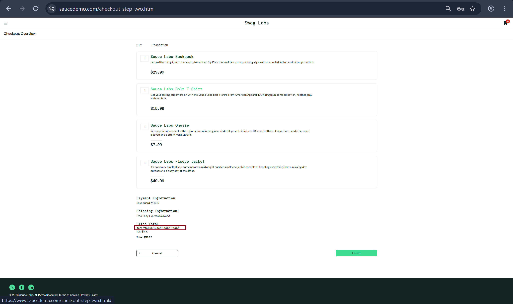

# BUG-018: [Checkout] Item total is shown with floating-point digits ($103.96000000000001) for some product combinations

| Field                    | Value           |
| ------------------------ | --------------- |
| **Bug ID**               | BUG-018         |
| **Module**               | Checkout        |
| **Test account**         | `standard_user` |
| **Severity**             | Low             |
| **Priority**             | Medium          |
| **Status**               | Open            |
| **Related test case(s)** | TC-CHK-16       |
| **Requirement**          | REQ-10          |
| **Reported by**          | Hanh Le         |
| **Reported on**          | 25/11/2026      |

## Environment

- **URL:** https://www.saucedemo.com
- **Browser:** Chromium 158.0.8127.18 (Playwright, headless)
- **OS:** Windows 11 Home 25H2

## Preconditions

- Logged in as `standard_user`.
- On the Products page (/inventory.html); cart is empty.

## Steps to Reproduce

1. Click 'Add to cart' for Sauce Labs Backpack, Sauce Labs Bolt T-Shirt, Sauce Labs Onesie and Sauce Labs Fleece Jacket.
2. Click the cart icon, then click 'Checkout'.
3. Enter First Name `John`, Last Name `Doe`, Postal Code `70000` and click 'Continue'.
4. Check the 'Price Total' section on 'Checkout: Overview'.

## Expected Result

- Item total: **$103.96** (29.99 + 15.99 + 7.99 + 49.99).
- All amounts are shown with exactly 2 decimals.

## Actual Result

- Item total is shown as **$103.96000000000001**.
- Tax ($8.32) and Total ($112.28) are correct and shown with 2 decimals.

## Evidence

## Notes

- Found by the automated test `TC-CHK-16 Price calculation – Four products (rounding case)` in `automation/tests/checkout.spec.ts`. The test is marked `test.fail(true, 'BUG-018')` until the bug is fixed.
- Reproduced on every run.
- Likely cause: the item total is the sum of the prices as floating-point numbers and is displayed without rounding to 2 decimals (Tax and Total are rounded). Other combinations tested (1, 2 and 6 products) display correctly.
- Severity is Low because the amount charged (Total) is correct; Priority is Medium because a wrong-looking price on the checkout page reduces user trust.
